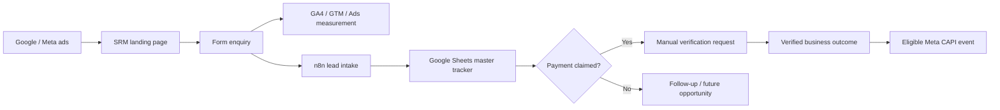

# From Landing Page to Payment: Heart2Heart's Marketing & Sales Automation

**Landing page development · Google Ads & conversion tracking · Meta Conversions API · n8n · Google Sheets · Gmail**

**Built by Grace Omolola Odukoya for Heart2Heart Enterprise.**

## The challenge

Someone clicks your ad. They like what they see. They fill out your form. Then they say they've paid.

Can your team follow that journey from the first click to a verified payment? What happens to people who enquire, leave, and need a follow-up?

For Heart2Heart Enterprise's SRM programme, I worked on connecting the pieces of that journey so enquiries could be captured, organized, measured, and followed up without relying on someone to remember every step.

## What I built

I developed the system in stages:

| Stage | What I implemented | Why it matters |
| --- | --- | --- |
| **1. Landing page** | A programme landing page designed to turn interest into enquiries | Gives visitors a clear next step |
| **2. Google measurement** | Google Tag Manager (GTM), Google Analytics 4 (GA4), Google Ads conversion tracking | Supports measurement of campaign and website actions |
| **3. Meta measurement** | Server-side conversion-event routing with Meta Conversions API | Connects eligible business events to advertising measurement |
| **4. Lead intake** | An n8n workflow that cleans form entries and writes them to a master Google Sheets tracker | Keeps enquiries organized |
| **5. Payment and follow-up** | Payment-claim checks, verification requests, lead statuses, and routed Gmail notifications | Helps the team see which enquiries need attention |

**Important payment distinction:** A prospect saying they paid triggers a **pending verification** process. The exported workflow does not independently confirm a bank transaction.

## How the system fits together

This diagram shows the **overall project architecture**. The GitHub export in this repository covers the n8n lead intake, tracking, payment-claim, and follow-up portion. The original landing-page source and Google Ads/GTM account exports are not included.

## Explore the code

- **[n8n workflow JSON](workflows/17-h2h-srm-path-a-lead-intake.json):** The sanitized, 14-node lead intake and payment-tracking export
- **[Node-by-node workflow map](docs/WORKFLOW_MAP.md):** What each node does
- **[Reproduction checklist](docs/REPLICATION_CHECKLIST.md):** Test setup and verification steps
- **[Review and test findings](docs/REVIEW_AND_TEST_RESULTS.md):** What passed offline and what still needs attention
- **[Meta CAPI companion project](https://github.com/graceomolola001-cmyk/meta-conversions-event-routing):** Server-side conversion-event routing

## Try it in a test environment

1. Import the JSON file into a **test** n8n instance. Keep it inactive while configuring it.
2. Create fictional Google Sheets for form submissions, the master tracker, and payment verification. Match the column headers used by the nodes.
3. Reconnect your own Google Sheets and Gmail credentials. Replace every placeholder and route notifications to a test inbox.
4. Test three submissions: no payment, payment claimed but unverified, and payment independently verified.
5. Check that statuses, tracker rows, and follow-up routes match expectations **before enabling live triggers**.

The export currently generates a new random lead ID on reprocessing and may create duplicates. Its sheet matching configuration also needs testing. Those are open engineering issues, documented in the [review](docs/REVIEW_AND_TEST_RESULTS.md).

## What this project demonstrates

I can connect **web development, acquisition tracking, server-side measurement, and business operations** into a coherent customer journey. The published code makes the lead-operations portion inspectable and reproducible.

Offline tests verified selected cleanup and payment-claim logic. Live end-to-end delivery, payment verification, and advertising attribution have **not** been independently validated for this public export. No revenue or conversion uplift is claimed.

**Privacy:** Use synthetic leads when testing. Never commit actual customer records, account access tokens, bank details, or live webhook URLs.
