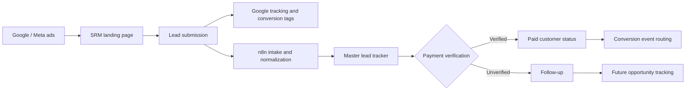

# Heart2Heart Enterprise | Landing Page, Conversion Tracking & Payment Automation

**Project implementation: Grace Omolola Odukoya.** This repository documents an integrated digital-acquisition and lead-operations implementation created for Heart2Heart Enterprise and the SRM programme.

## The story

A prospect can discover a programme through an advertisement, visit a landing page and express interest. But the business still needs to know what happened next: did the prospect submit a form, pay, need a follow-up, or become a future sales opportunity? Missing this connection wastes marketing spend and creates manual work for the team.

Grace implemented the project across successive layers:

1. **Landing page:** designed and developed the page that introduced the programme and captured interested prospects.
2. **Measurement:** configured Google tracking (Google Tag Manager, Google Analytics 4, and relevant conversion events) and Google Ads conversion tracking for the acquisition journey.
3. **Meta Conversions API:** added server-side conversion-event routing to connect business events with Meta measurement, subject to API configuration and consent.
4. **Lead operations:** developed an n8n workflow to read lead submissions, normalize data and maintain a master tracker.
5. **Payment and follow-up:** built a payment-status workflow that checks the tracking sheet, distinguishes claimed from verified payment, and routes relevant leads for follow-up and subsequent sales opportunities.

## What this repository contains

The reproducible, sanitized **H2H SRM | Path A | Lead Intake** n8n workflow is the code artifact for the lead and payment-tracking stage. The landing page source, Google Ads account configuration, GTM container and live Meta credentials are **not included** in this repository. A related [Meta Conversions Event Routing](https://github.com/graceomolola001-cmyk/meta-conversions-event-routing) repository covers the Meta workflow separately.

## End-to-end architecture

*Conceptual architecture of the broader project. The exported n8n workflow alone does not verify each external integration or prove live performance.*

## Replicate the lead workflow

1. Import the sanitized workflow from `workflows/` into a **test** n8n instance.
2. Inspect all Google Sheets column names and create corresponding *synthetic* tabs for form submissions, master tracking and payment verification.
3. Reconnect Google Sheets and Gmail with **your own** OAuth credentials. Update every placeholder and test recipient.
4. Run three test submissions: verified payment, claimed but unverified payment, and no payment with a follow-up request.
5. Check the master tracker, email routing, duplicate behavior and payment status. Never treat a claimed payment as verified without checking your independent evidence.
6. Configure GA4/GTM and Google Ads separately, validate your conversion-event triggers, and use Meta test events when reviewing the companion Meta workflow.

## What a prospective client can learn

This project shows how landing page creation, attribution, lead tracking and payment operations fit together as one measurable customer journey. The workflows illustrate implementation, not verified revenue uplift or complete production readiness.

## Safety

The public version must not contain real leads, account details, pixel IDs, payment references, personal email addresses, access tokens, or live webhook URLs. Keep your landing-page assets and live ad-account exports private unless separately reviewed.
